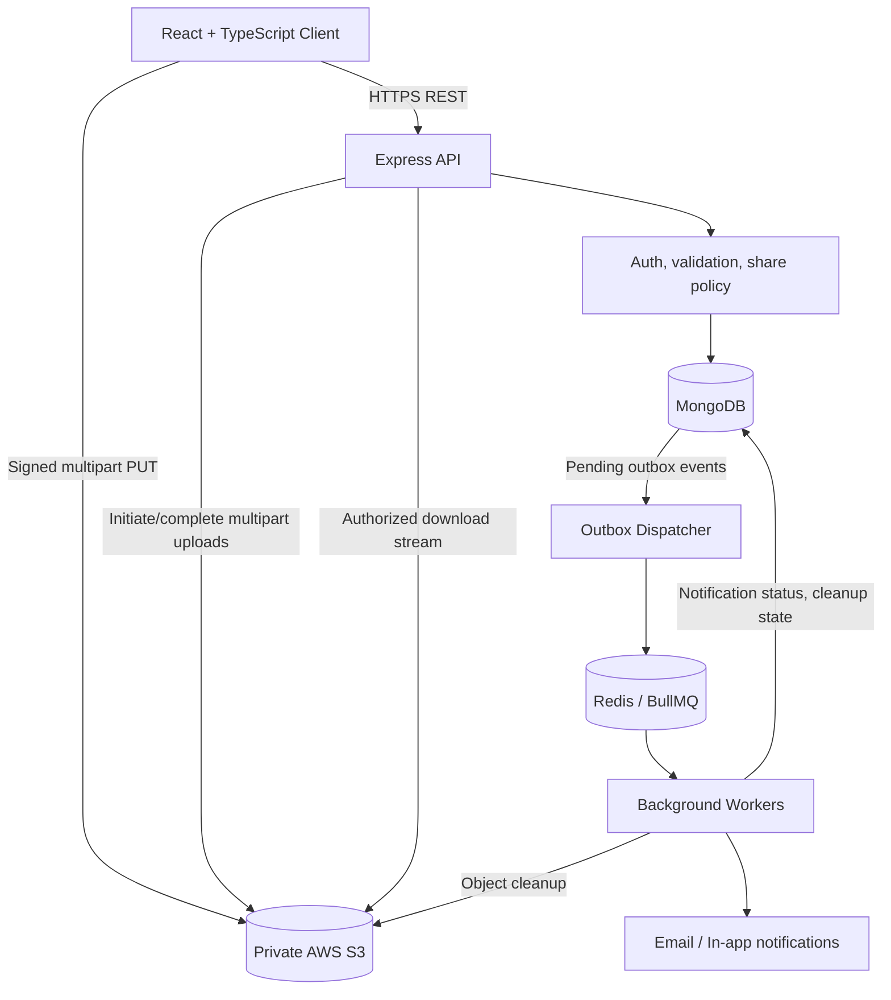
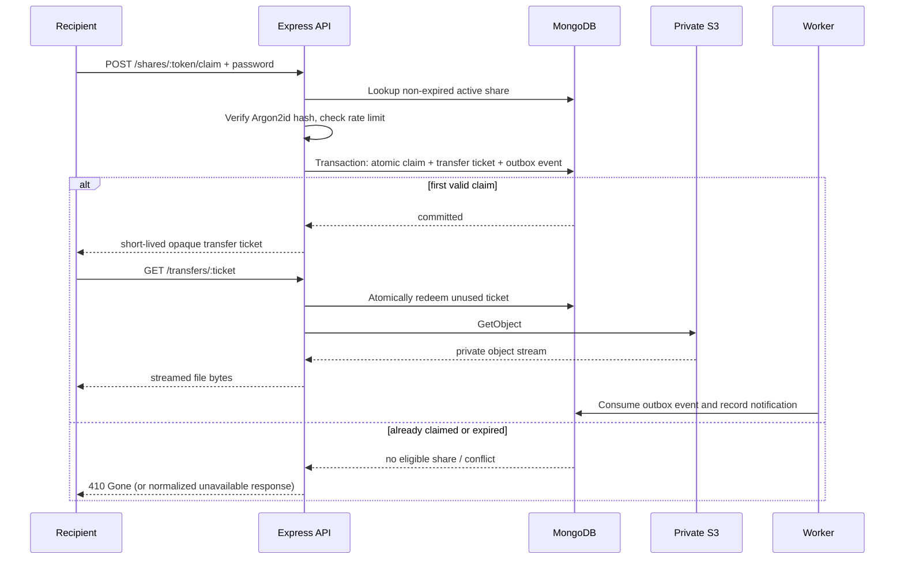

# SnapShare

**Secure, temporary file and code snippet sharing — built for real-world reliability.**

> **Project status:** Phases 1 and 2 are implemented: account sessions, private multipart uploads with resume/abort, and safe code snippets. Files remain quarantined pending a trusted scanner. Public shares and downloads are planned for Phase 3. Local tests use an S3 HTTP emulator; persistent Docker services and real AWS storage still need verification. See [Phase 2 setup and recovery](docs/phase-2.md) and [progress](docs/progress.md).

SnapShare is a full-stack platform for uploading files or sharing code snippets through secure links with **expiration policies, password protection, download limits, resumable uploads, notifications, and automatic cloud cleanup**.

The flagship policy is **24-hour expiry + one-time claim + required password + uploader notification**.

## Contents

- [Why SnapShare?](#why-snapshare)
- [Core features](#core-features)
- [Technology stack](#technology-stack)
- [System architecture](#system-architecture)
- [Repository structure](#repository-structure)
- [Data model](#data-model)
- [End-to-end workflows](#end-to-end-workflows)
- [API design](#api-design)
- [Security and concurrency](#security-and-concurrency)
- [Workers and cleanup](#workers-and-cleanup)
- [Local development](#local-development)
- [Testing](#testing)
- [Roadmap](#roadmap)
- [Engineering decisions](#engineering-decisions)
- [Demo and documentation](#demo-and-documentation)

## Why SnapShare?

Permanent cloud folders aren't ideal when someone only needs a document or snippet briefly. SnapShare focuses on **temporary access with explicit controls**: *who can open it, how long it remains available, and how many times it may be claimed.*

This project is designed to demonstrate full-stack engineering beyond basic CRUD: cloud upload protocols, authorization, MongoDB atomic operations, background job reliability, failure recovery, and operational observability.

## Implemented foundation

- [x] pnpm workspaces, strict TypeScript and shared Zod contracts/config.
- [x] React/Vite, Tailwind, shadcn-style Button, React Router and TanStack Query.
- [x] Sign In, Sign Up and protected Dashboard with mobile layouts.
- [x] Express, environment validation, Helmet, CORS, origin checks, safe errors and structured logs.
- [x] Argon2id passwords, opaque cookie sessions and hashed session tokens in MongoDB.
- [x] Registration/login/logout, current-account endpoint and authentication rate limits.
- [x] MongoDB replica-set and Redis Compose configuration; separate worker scaffold.
- [x] Unit/integration tests, browser smoke checks and baseline CI configuration.
- [ ] Verify Compose services and Redis worker startup with Docker installed.

## Core features

### Sharing experience

- [x] Upload supported files (documents, images, archives, etc.) to **private S3 storage**.
- [x] Create syntax-highlighted code snippets with a copy-friendly viewer.
- [ ] Generate high-entropy, unguessable share URLs.
- [ ] Choose expiration presets (1 hour, **24 hours**, 7 days).
- [ ] Protect links with a password (Argon2id hashing).
- [ ] Support a **single-use claim** or configurable download limits.
- [ ] View, revoke, and track shares from a user dashboard.
- [ ] Show link status and optional in-app/email notifications.

### Advanced engineering

- [x] Upload large files directly to S3 with **multipart uploads** and retry/resume support.
- [ ] Atomically claim one-time links even under concurrent requests.
- [ ] Stream protected downloads through the API without exposing reusable object URLs.
- [ ] Create transfer tickets and outbox events in the same MongoDB transaction as a successful claim.
- [ ] Run Redis/BullMQ workers for notifications and cloud-object cleanup.
- [ ] Recover from failed cleanup, lost jobs, and abandoned uploads via reconciliation.
- [ ] Add rate limits, quotas, validations, audit events, and monitoring.
- [ ] Test authorization, concurrency, failure recovery, and end-to-end sharing.

## Technology stack

| Layer | Technology | Role |
|---|---|---|
| Frontend | React, Vite, TypeScript, Tailwind CSS, shadcn/ui | User interface |
| Client data | TanStack Query | Remote state and mutations |
| Backend | Node.js, Express, TypeScript | REST API and business logic |
| Validation | Zod | Shared request/response contracts |
| Database | MongoDB Atlas, Mongoose | Metadata, sessions, claims, outbox |
| Object storage | AWS S3 | Private file bytes, multipart uploads |
| Queues | Redis, BullMQ | Background jobs and retries |
| Authentication | Secure HTTP-only cookie sessions | Account authentication |
| Password hashing | Argon2id | Share/account password verification |
| Tests | Vitest, Supertest, Playwright, k6 | Unit, integration, E2E, load |
| DevOps | Docker, GitHub Actions | Local infrastructure and CI/CD |

Start with a **modular monolith** for the API and a **separately deployed worker**; do not introduce microservices without demonstrated need.

## System architecture



**Key distinction:** Upload bytes flow **browser → S3** using scoped, short-lived signed URLs. Protected single-use download bytes flow **S3 → Express → recipient** after an atomic claim and ticket redemption.

## Repository structure

This is the **target** monorepo layout, not a statement that every file currently exists:

```text
snapshare/
├── apps/
│   ├── web/
│   │   └── src/
│   │       ├── app/                 # Routes and providers
│   │       ├── pages/               # Upload, share access, dashboard
│   │       ├── features/            # auth, uploads, shares, analytics
│   │       ├── components/
│   │       ├── hooks/
│   │       └── lib/
│   ├── api/
│   │   └── src/
│   │       ├── app.ts
│   │       ├── server.ts
│   │       ├── config/
│   │       ├── middleware/          # auth, rate limiting, errors
│   │       ├── modules/
│   │       │   ├── auth/
│   │       │   ├── uploads/
│   │       │   ├── shares/
│   │       │   ├── transfers/
│   │       │   ├── snippets/
│   │       │   ├── notifications/
│   │       │   └── analytics/
│   │       └── infrastructure/      # database, S3, queues, logging
│   └── worker/
│       └── src/
│           ├── index.ts
│           ├── cleanup.worker.ts
│           ├── notification.worker.ts
│           ├── outbox.dispatcher.ts
│           └── reconciliation.worker.ts
├── packages/
│   ├── contracts/                   # Shared Zod schemas and DTOs
│   ├── config/
│   └── utilities/
├── tests/
│   ├── integration/
│   ├── concurrency/
│   └── e2e/
├── infra/docker/
├── docs/
├── .github/workflows/
├── docker-compose.yml
├── pnpm-workspace.yaml
└── README.md
```

Within each backend feature module, use **routes → controller → service → repository → model**, with policy checks separated from HTTP concerns.

## Data model

| Collection | Selected fields | Purpose |
|---|---|---|
| `users` | `email`, `passwordHash`, `name` | Accounts |
| `sessions` | `userId`, `tokenHash`, `expiresAt` | Authenticated sessions |
| `upload_sessions` | `ownerId`, `uploadId`, `objectKey`, `parts`, `status` | Multipart upload recovery |
| `shares` | `ownerId`, `tokenHash`, `objectKey` or `snippetId`, `passwordHash`, `expiresAt`, `status`, `downloadCount`, `cleanupStatus` | Share policy and lifecycle |
| `transfer_tickets` | `ticketHash`, `shareId`, `status`, `expiresAt` | One-time transfer authorization |
| `snippets` | `shareId`, `language`, `content`, `version` | Text/code sharing |
| `outbox_events` | `type`, `shareId`, `payload`, `processedAt` | Durable asynchronous actions |
| `notifications` | `userId`, `sourceEventId`, `readAt` | Owner alerts |
| `download_events` | `shareId`, `type`, `createdAt` | Minimal auditing/analytics |

Suggested indexes:

```javascript
db.shares.createIndex({ tokenHash: 1 }, { unique: true });
db.shares.createIndex({ status: 1, expiresAt: 1 });
db.shares.createIndex({ ownerId: 1, createdAt: -1 });
db.transfer_tickets.createIndex({ ticketHash: 1 }, { unique: true });
db.notifications.createIndex({ sourceEventId: 1 }, { unique: true });
```

**Do not TTL-delete `shares` at `expiresAt`:** object storage cleanup may still be pending. Reject access immediately based on `expiresAt`; only assign a separate `purgeAfter` TTL timestamp after confirmed cleanup and the intended retention period.

## End-to-end workflows

### A. Resumable upload

1. Authenticated client calls `POST /api/uploads/initiate` with file metadata.
2. API validates quotas, size, type, and ownership and initiates an S3 multipart upload.
3. Client requests signed URLs for individual parts, then uploads parts **directly to S3**.
4. Server lists storage-confirmed parts and ETags; the browser skips completed parts and can resume after reselecting the original file.
5. Client calls `POST /api/uploads/:id/complete`; API verifies session ownership, parts, and resulting object.
6. A verified upload enters quarantine pending malware scanning. Owners can abort unfinished uploads. Automatic reconciliation and share creation remain future phases.

### B. Secure share creation

1. Authenticated owner selects a verified upload or snippet.
2. API validates the selected share policy and hashes the share password with Argon2id.
3. API generates a cryptographically random token and stores **only its hash**.
4. API stores `expiresAt = createdAt + 24 hours`, `maxDownloads = 1`, `downloadCount = 0`, and `notificationsEnabled = true`.
5. Owner receives a URL such as `https://<your-domain>/s/<random-token>`.

### C. One-time claim and download



**Semantics:** A one-time link permits **at most one committed claim**, not guaranteed exactly-once successful delivery. If a transfer fails after the claim, the link remains consumed. A returned S3 presigned GET URL is **not** used because it can be reused while valid.

### D. Automatic cleanup

1. Share becomes unavailable when expired, revoked, or claimed.
2. Cleanup is queued after there is no active transfer or the transfer's maximum window has elapsed.
3. Worker deletes the S3 object, recording completion or retryable failure.
4. Reconciliation scans for overdue/dead-lettered cleanup and abandoned upload sessions.
5. Metadata receives `purgeAfter` only after required cleanup and retention obligations are satisfied.

## API design

**Draft API contract; adjust payloads as implementation evolves.**

| Method | Route | Behavior |
|---|---|---|
| `POST` | `/api/auth/register` | Register |
| `POST` | `/api/auth/login` | Start authenticated session |
| `POST` | `/api/auth/logout` | End session |
| `POST` | `/api/uploads/initiate` | Begin multipart upload |
| `POST` | `/api/uploads/:id/parts` | Request signed part URLs |
| `GET` | `/api/uploads/:id` | Inspect upload progress |
| `POST` | `/api/uploads/:id/complete` | Complete and verify upload |
| `DELETE` | `/api/uploads/:id` | Abort multipart upload |
| `POST` | `/api/shares` | Create share from verified upload/snippet |
| `GET` | `/api/shares/:token` | Safe public metadata only |
| `POST` | `/api/shares/:token/claim` | Verify password and atomically claim |
| `GET` | `/api/transfers/:ticket` | Redeem ticket and stream private bytes |
| `GET` | `/api/me/shares` | Owner's share history |
| `DELETE` | `/api/me/shares/:id` | Revoke an owned share |
| `GET` | `/api/me/notifications` | Owner's in-app notifications |
| `GET` | `/api/me/analytics` | Aggregated share activity |

Example share creation payload:

```json
{
  "uploadId": "verified-upload-session-id",
  "password": "choose-a-strong-password",
  "expiresInHours": 24,
  "maxDownloads": 1,
  "notificationsEnabled": true
}
```

The server must resolve `uploadId` to an upload verified and owned by the authenticated user. Never trust an arbitrary client-supplied S3 object key.

## Security and concurrency

### Share claim invariant

The claim must atomically transition **`active → claimed`** only when:

```text
status == active
AND expiresAt > now
AND downloadCount < maxDownloads
AND password was verified
```

Implement a conditional MongoDB `findOneAndUpdate` inside a transaction that also writes the **transfer ticket** and **outbox event**. In concurrent races, only one transaction may commit the successful claim. Handle write conflicts and bounded retries carefully. Use a MongoDB **replica set** for multi-document transactions.

### Transfer tickets

- Generate high-entropy opaque tickets; store their hashes.
- Create ticket **in the same transaction** as the claim.
- Use short ticket start deadlines and atomic `issued → redeemed` transition.
- Reject replays; stream private objects only from the authorized backend route.
- Do not support unrestricted HTTP range replay in the initial one-time implementation.
- Optionally support client-provided idempotency keys so a lost claim response does not consume the link without a recoverable ticket.

### Security checklist

- HTTP-only, `Secure`, appropriately `SameSite` cookies; CSRF defenses where needed.
- Strong share token entropy; never log raw tokens or passwords.
- Argon2id for share passwords and account passwords.
- Rate limiting on login, share password attempts, upload creation, and claims.
- Validate size, MIME/content type, allowed extensions, and user quotas.
- S3 bucket private by default; least-privilege IAM access and scoped presigned upload URLs.
- Quarantine/scan risky uploads before making them downloadable.
- Render snippets as inert text, never executable HTML.
- Restrict CORS origins, sanitize file download headers, and handle all errors safely.
- Collect minimal access analytics; avoid logging sensitive URLs.

## Workers and cleanup

**Outbox dispatcher:** Polls unpublished MongoDB events, enqueues BullMQ jobs with stable event IDs, and marks dispatch progress. Dispatch may repeat, so consumers must be idempotent.

**Notification worker:** Creates one in-app notification per unique event and optionally sends an email. Notification text says **"share claimed"**, not "recipient finished downloading," unless completion is separately verified.

**Cleanup worker:** Deletes expired, revoked, or consumed file objects only after authorized transfers finish/time out. Uses retries with backoff and explicit cleanup states.

**Reconciliation worker:** Periodically identifies missing cleanup jobs, failed object deletions, orphaned objects, and incomplete multipart uploads.

## Local development

> Auth, uploads and snippets are runnable. Follow [Phase 2 development instructions](docs/phase-2.md) for storage setup, recovery policy, API details and known limitations. Docker service runtime remains unverified locally.

### Prerequisites

- Node.js 22.12+, pnpm 12.11.2, Docker + Docker Compose
- A MongoDB replica set (local or Atlas) and Redis
- Local S3 emulator included in Compose, or a separately provisioned private AWS S3 bucket.

### Current commands

```bash
pnpm install --frozen-lockfile
cp .env.example .env
pnpm services:up
pnpm storage:setup
pnpm dev
```

Open `http://localhost:5173`; the frontend proxies `/api` to port 4000. On PowerShell use `Copy-Item .env.example .env`. The root `.env` is read only by backend processes. `APP_URL` must match the browser's exact origin without a trailing slash.

Available routes: `GET /api/health`, `GET /api/ready`, `GET /api/auth/me`, and `POST /api/auth/register`, `/api/auth/login`, `/api/auth/logout`. Mutations require the allowed Origin and JSON content type. Upload and snippet routes are also implemented; see [Phase 2 API](docs/phase-2.md#api-and-policy). Shares, transfers, notifications and analytics remain future contracts.

### Current `.env.example` keys

```dotenv
NODE_ENV=development
APP_URL=http://localhost:5173
API_PORT=4000
MONGODB_URI=mongodb://localhost:27017/snapshare?replicaSet=rs0
REDIS_URL=redis://localhost:6379
SESSION_DAYS=7
LOG_LEVEL=info
S3_BUCKET=snapshare-private
S3_REGION=us-east-1
S3_ENDPOINT=http://127.0.0.1:9000
S3_ACCESS_KEY_ID=local-development
S3_SECRET_ACCESS_KEY=local-development
```

Sessions use random opaque secrets with hashes stored server-side; a cookie-signing secret is unnecessary for this lookup design. S3 example credentials are for the loopback development emulator only. Use an IAM role and private AWS bucket for production; email settings arrive in a later phase. **Never place secrets in frontend variables or source control.** Ensure the MongoDB URI matches the replica-set configuration.

## Testing

Current tests cover authentication plus upload ownership, part verification, quota races, completion recovery, abort retries and snippet byte limits. Browser checks cover account flows and HTTP multipart resume, byte verification, anonymous access denial and inert snippet rendering. Broader planned coverage:

| Level | What to verify |
|---|---|
| Unit | Expiration, policy decisions, token generation, validators |
| Integration | Auth, MongoDB transactions, upload state, ticket redemption |
| Concurrency | 20 simultaneous valid claims → exactly **one** success |
| Storage | Multipart retries, complete/abort, missing object, interrupted stream |
| Workers | Duplicate jobs, backoff, cleanup failure, reconciliation |
| Security | Wrong password, brute-force limits, unauthorized object access |
| E2E | Upload → link → password → claim → download → expire/cleanup |
| Load | API latency, simultaneous transfers, memory, queue lag |

### Current foundation checks

```bash
pnpm test
pnpm test:integration
pnpm test:browser
pnpm lint
pnpm typecheck
```

Record real measured numbers (for example, p95 API latency, tested concurrency, retry recovery rate) in `docs/performance.md` once benchmarks have been run. **Do not invent performance claims.**

## Roadmap

| Phase | Deliverable | Status |
|---|---|---|
| **1. Foundation** | Monorepo, React UI shell, Express API, MongoDB, Docker | Implemented; Docker runtime verification pending |
| **2. Private storage and snippets** | Multipart upload/resume/abort, quarantine, safe snippet editor | Implemented; real AWS/Compose verification pending |
| **3. Secure sharing** | Passwords, expiry, atomic claims, tickets, controlled streaming, outbox | Planned |
| **4. Durable background work** | Notifications, cleanup, retries, reconciliation | Planned |
| **5. Product and performance** | Full UI, analytics, hardening, measured benchmarks | Planned |
| **6. Deployment and operations** | Deployment, monitoring, runbooks, portfolio documentation | Planned |

Phases follow [prompt.md](prompt.md). The earlier roadmap grouped streaming/background work differently; the implementation plan is now reflected here.

## Engineering decisions

| Decision | Why |
|---|---|
| **MongoDB for metadata; S3 for objects** | Database queries remain small while binary files live in purpose-built storage |
| **Direct-to-S3 multipart uploads** | Large uploads do not monopolize API bandwidth and can be resumed |
| **API-proxied one-time downloads** | A reusable S3 presigned URL cannot enforce strict single-use access |
| **Atomic claim + ticket + outbox transaction** | Prevents multiple winners and partially persisted claims |
| **Outbox + BullMQ** | Durable intent for async processing, with retries and deduplication |
| **TTL only after cleanup** | Avoids losing the object key before cloud deletion succeeds |
| **Modular monolith + worker** | Clear boundaries without premature microservices |

### Known trade-offs

- **One claim ≠ verified successful download.** A failed transfer still consumes the share in the first version.
- **API-proxied downloads cost bandwidth.** This is the deliberate trade-off for strict single-use behavior; benchmark and provision accordingly.
- **Queues are not exactly-once systems.** Handlers should tolerate redelivery.
- **24-hour expiry means immediate access rejection, not guaranteed immediate S3 deletion.** Cleanup is asynchronous and monitored.

## Demo and documentation

Add these once they exist:

- **Live app:** `TBD`
- **API documentation:** `TBD`
- **Demo video:** `TBD`
- **Architecture decisions:** `docs/decisions/`
- **Performance report:** `docs/performance.md`
- **Screenshots:** `docs/screenshots/`

---

**Built as a full-stack SDE portfolio project focused on secure file handling, concurrency, cloud infrastructure, and production-grade backend design.**
