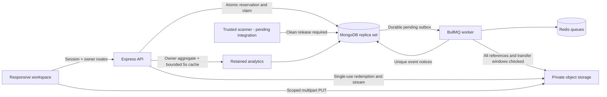

# Phase 5: product UI, owner analytics and measured performance

Phase 5 completes the responsive workspace experience around the existing secure sharing engine. It adds owner analytics, share details/filtering, bounded list rendering, stronger creation budgets and file-type validation, and a reproducible k6 harness. The default policy stays 24-hour expiry, one committed claim, required password and notifications enabled.

## Run and explore

Use the [Phase 4 setup](phase-4.md#local-setup), then `pnpm dev`. No new backend secrets or environment variables are required. Use the Files, Snippets, My shares, Notifications and Analytics navigation links on the dashboard. On desktop, uploads and snippet editing sit side by side; on mobile, they stack without page overflow.

1. Upload a supported file, pause/disconnect and reselect the same file to resume. Completed uploads remain private and awaiting scan. File lists show cleanup/retry status and reveal another ten records when requested.
2. Save a snippet and inspect the escaped syntax-highlighted preview. Lists initially render ten snippets, with Show more for the bounded workspace list. Copy returns original text.
3. Create a share with a required password. Save/copy its URL immediately; raw tokens cannot be reconstructed after leaving the page. Filter My shares by active, claimed, expired or revoked state; older pages use the owner-scoped cursor API. Details show claim/transfer/cleanup state without exposing token hashes, passwords, object keys or raw tickets. Revoke blocks future access.
4. Open a link without signing in. Details remain hidden before authorization. Claim, then start its one-time download within the existing deadline. A failed stream stays consumed. Session-scoped recovery of a lost claim response is unchanged.
5. View claim notices, mark them read and paginate older notifications.
6. Open Analytics, select seven or thirty UTC days, inspect the chart or accessible data table, and refresh. A separate account sees only its own data.

## Analytics semantics and API

`GET /api/me/analytics?days=7` accepts only days=7 or days=30. It requires the existing valid account session, limits requests to 60/minute per owner, rejects unknown/structured/duplicate query values and returns no-store responses. The API returns sampledAt, days, totals, storage and activity. It never includes access IPs, raw tokens, user agents, passwords, object keys or snippet text.

Totals cover retained owner records: uploads, live snippets, shares/claims, currently active shares, expired records, revoked shares, failed/finished transfers, waiting/completed cleanup, pending scans and file cleanup failures. Expired means expiresAt is past, so it can overlap claimed/revoked; these counters are not a mutually exclusive state breakdown. Transfers are joined only after matching the owner shares. Finished means the API streamed bytes, not that a recipient saved them.

Storage distinguishes quota reservations from completed file-object bytes. Reserved bytes include unfinished files and snippets until abort or verified cleanup. The quota remains 1 GiB and 100 asset items. Stored file bytes continue to count while deletion is unverified. The activity series uses UTC calendar days and retains exact counts in an accessible table. Ticket creation dates represent claims; failure counts on a day refer to those tickets, not a separately collected timestamp for each network error.

Purged metadata is excluded. Private snippets and other retained records may outlive the activity period. These are retained-record summaries, not lifetime business analytics or guaranteed physical cloud billing measurements. No additional recipient tracking collection is introduced.

Database aggregation performs the reductions. Results are cached for at most five seconds per owner/period, and the original sample time remains visible. Concurrent matching requests share one pending read; the cache is bounded to 500 entries and pending distinct reads to 100. Refresh can return the current five-second sample. Authentication is checked on every request; access authorization, expiry, revocation, claims and ticket redemption are never cached. The dashboard polls every fifteen seconds. Added owner/createdAt indexing supports the query shape; existing token, owner/cursor and ticket/share indexes remain in use.

Owner details are available at `GET /api/me/shares/:id`. `GET /api/me/shares` supports the existing before cursor and an optional validated state=active|expired|claimed|revoked filter. Foreign IDs return 404. Invalid/unknown query keys return 400. The detail route uses the existing authenticated owner rate limit.

## Hardening and explicit nonproduction limits

Filename extensions must match the declared supported MIME type: pdf, png, jpg/jpeg, txt or zip. Path/control characters, unsupported types, invalid fingerprints, byte limits and ownership remain validated. This is declaration/extension validation, not content detection. Misleading HTML filenames are rejected before a storage session is created. Browser file identity hashing now processes 2 MiB chunks with incremental SHA-256, preserving compatibility with existing resume fingerprints without allocating the whole maximum-sized file. Progress and pause remain available while hashing/uploading.

A workspace can retain at most 500 shares. A transaction serializes budget checks through its quota document even when concurrent creations use different assets; metadata TTL eventually frees retained-share capacity. This budget is separate from the existing atomic 1 GiB/100-item asset reservation. No client can override share expiry, claim count, password requirement or notification defaults.

Existing controls remain: Argon2id, hashed opaque bearers, exact-Origin JSON mutations, security headers, no-store private responses, strict DTOs, scoped multipart URLs, safe attachment streaming, request IDs and secret-free application logs. Owner-facing analytics/detail queries explicitly project/map safe outputs. No production endpoint or flag exposes the benchmark baseline, lowers rate limits, or releases unscanned files.

**Nonproduction limitation:** there is no malware scanner/content-detection integration yet. Ordinary uploads remain quarantined and cannot be shared until an external trusted process marks a clean result. Browser tests explicitly seed that trusted result; this is not a scan. There is no unscanned-file demo bypass. Snippet sharing works immediately and renders code/HTML as inert text or attachment bytes. Real AWS IAM/lifecycle, production frontend hosting/headers, persistent Docker runtime, email delivery, reverse-proxy trust and distributed rate-limit storage still require target-environment verification. Current IP/account rate limits and caches are process-local and must not be presented as cluster-wide protection.

## Updated architecture



The [desktop workspace](screenshots/phase-5-workspace-desktop.png), [desktop analytics](screenshots/phase-5-analytics-desktop.png) and [mobile analytics](screenshots/phase-5-analytics-mobile.png) screenshots were captured from the running local app and visually reviewed. Test data includes simulated clean scan outcomes and elapsed transfer deadlines. These are application screenshots, not generated mockups.

## Verification and performance

```powershell
pnpm install --frozen-lockfile
pnpm lint
pnpm typecheck
pnpm test
pnpm build
$env:CHROMIUM_CHANNEL='chrome'
$env:REDIS_SERVER_PATH='C:/path/to/redis-server.exe'
pnpm test:browser
python -m pip install -r tests/requirements-storage.txt
pnpm test:browser:workspace
pnpm test:worker
$env:K6_PATH='C:/path/to/k6.exe'
pnpm benchmark
git diff --check
```

All 46 unit/integration tests passed, including analytics ownership and aggregate semantics, strict query validation/rate limits, cursor/filter behavior, safe share details, concurrent retained-share budget enforcement and cache isolation/expiry/coalescing. The existing 20-way claim race still permits exactly one winner. Both browser commands and the real Redis/BullMQ worker smoke passed. Browser coverage now includes misleading file rejection, chunked hash/resume, secure download/recovery, worker notices/cleanup, share details/filters, seven/thirty-day analytics, accessible data tables and a second owner on mobile. No page errors or horizontal page overflow were observed at the checked viewports.

k6 measured real initiation, generic public metadata lookup, password/claim and streamed downloads against isolated local MongoDB and an S3 emulator. It also compared a warmed, uncached document-reduction analytics baseline with the five-second cached aggregation implementation, checking equal outputs first. The [performance report](performance.md) records exact median/p95/throughput, versions, dataset, sample sizes and limitations; [raw metrics](performance-results.json) contain no fixture credentials. Small two-VU local runs do not establish production capacity or an SLA. Existing third-party Zod/Rollup annotation warnings remain harmless build output. CI automatically includes the new tests through its existing suite/browser commands; k6 performance runs are explicit local checks, not a claimed remote CI result.

## Files and Phase 6 prerequisites

New API modules are analytics/{repository,service,controller,routes}; share repository/service/controller/routes add validated owner details/filtering and transactional share budgets. Shared contracts/model indexes and quota version fields support them. Frontend additions are Analytics.tsx and ShareDetails.tsx, with dashboard navigation, list controls, revised styles and incremental hashing in the workspace. Tests add analytics integration/cache cases and expand the existing browser flow. benchmarks/{baseline.ts,api.k6.js,run.ts}, package scripts and test typechecking provide reproducible measurement. README, progress, this document, measured reports and captured screenshots record actual scope.

Phase 6 should configure production hosting/containers, trusted proxy/distributed limits, scanner integration, private durable storage, credentials, monitoring, runbooks and deployment. No deployment, real AWS validation, production scanner/email integration, internet throughput or production security certification is claimed by Phase 5.
